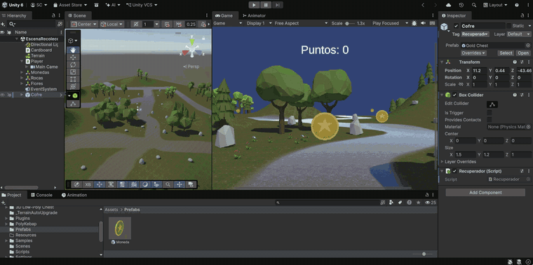
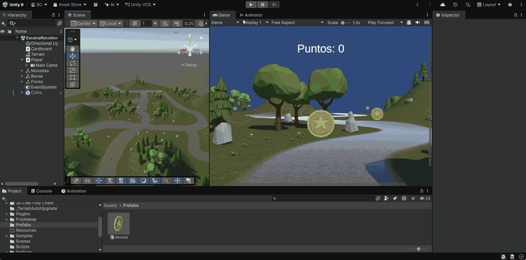

# Práctica 5 - Realidad Virtual con Google Cardboard en Unity

**Autor:** Sergio Rosales Calzadilla (alu0101635590@ull.edu.es)

Esta práctica de la asignatura **Interfaces Inteligentes** se centra en el desarrollo de una aplicación de **realidad virtual para Android** con el **Cardboard XR Plugin** de Google. El jugador se mueve por un terreno y se relaciona con la escena **únicamente con la mirada**: desde la cámara se lanza un rayo (`Physics.Raycast`) en la dirección en la que mira, y según el objeto que toca, el jugador avanza, recoge monedas o activa un cofre que atrae a las monedas que quedan. Para comunicar los objetos se reutiliza el **patrón observador** (delegados y eventos) de la práctica anterior.

---

## Configuración común de la escena

El proyecto utiliza **Unity 6** con **URP** y el **Google Cardboard XR Plugin for Unity 1.36.0**, configurado siguiendo la [guía oficial de Google](https://developers.google.com/cardboard/develop/unity/quickstart?hl=es-419). La única diferencia es que el *Target API Level* se ha dejado en automático, porque con el nivel indicado en la guía no se podía compilar.

La escena de la práctica es `Assets/Scenes/EscenaRecoleccion.unity`. Se utilizan las siguientes **etiquetas** (*Tags*), que deben crearse en *Project Settings > Tags and Layers*:

| Etiqueta       | Se asigna a                                      |
|----------------|--------------------------------------------------|
| `Suelo`        | El `Terrain` (por el que se puede caminar)       |
| `Recolectable` | El prefab `Moneda` (todas las monedas)           |
| `Recuperador`  | El cofre que atrae a las monedas                 |

La jerarquía principal de la escena es la siguiente:

- **`Cardboard`**: objeto vacío con el script `CardboardStartup` del ejemplo del plugin. Mantiene la pantalla encendida, pide escanear el código QR de las gafas y atiende los botones de configuración y de salida.
- **`Player`**: tiene un `Rigidbody` (con *Freeze Rotation* en los tres ejes para que no se caiga) y un `Capsule Collider`. Dentro está la **`Main Camera`**, copiada de la escena de ejemplo `HelloCardboard`, que incluye el componente `Tracked Pose Driver` (hace que la cámara siga el movimiento de la cabeza) y la mira `CardboardReticlePointer`.
- **`Canvas`** en modo **World Space**, hijo de la cámara, con el texto del marcador. En realidad virtual la interfaz no puede ir pegada a la pantalla, sino flotando en el espacio 3D delante del jugador.

**Paquetes de la Asset Store utilizados:**

| Paquete                  | Uso en la escena                      |
|--------------------------|---------------------------------------|
| Terrain Textures Pack Free | Texturas del terreno (hierba, tierra) |
| Simple Nature Pack       | Árboles, rocas y flores               |
| Stylized Coin Pack       | Monedas recolectables                 |
| 3D Low-Poly Chest        | Cofre para recuperar las monedas      |

El proyecto usa el **nuevo Input System**, así que la lectura del teclado se hace con `Keyboard.current` en lugar de `Input.GetAxis()`.

---

## Ejercicios

### Ejercicio 1

> Crear el proyecto Cardboard, experimentar y generar una apk para Android.

Se crea el proyecto y se configura el plugin de Cardboard para Android, siguiendo la guía de Google:

- En *XR Plug-in Management* se activa el proveedor **Cardboard XR Plugin** para Android, con *Initialize XR on Startup*.
- En *Player Settings* se usa **IL2CPP** con arquitectura **ARM64**, las APIs gráficas **Vulkan** y **OpenGLES3**, la orientación **Landscape Left** y el *Minimum API Level* 26. Además se activan las plantillas personalizadas de Gradle (`mainTemplate.gradle` y `gradleTemplate.properties`) con las dependencias que indica la guía.
- Se importa la escena de ejemplo **HelloCardboard** y se prueba en un **Google Pixel 8**.

Al generar el primer APK solo se veía el cielo por defecto de Unity. El motivo era que en *Build Profiles > Scene List* la primera escena (índice 0) era `SampleScene`, la escena vacía de la plantilla, y Android siempre arranca la escena de índice 0. Al dejar en primera posición la escena de Cardboard, la aplicación se ve correctamente en modo realidad virtual, con la pantalla dividida para cada ojo.

### Ejercicio 2

> Crea una escena con Cardboard que tenga objetos que al llegar el jugador a ellos los recolecte con la vista. El jugador se puede desplazar con un mando o con la vista. La escena debe contener un terreno y objetos de algún paquete de la Asset Store.

Se crea un valle con un `Terrain` pintado con las texturas del paquete, con colinas en los bordes, árboles, rocas y flores. Por él se reparten monedas que giran sobre sí mismas. El jugador se desplaza **con la vista** y recoge las monedas **mirándolas** cuando está cerca.

- **`MovimientoJugador.cs`** (en el `Player`): en `FixedUpdate()` lanza un rayo desde la cámara hacia donde mira, con un alcance de `distanciaMirarSuelo` (10 m). Si el rayo choca con un objeto con la etiqueta `Suelo`, el jugador avanza en la dirección de la mirada. La dirección se obtiene de `camara.forward` poniendo su componente `y` a 0 y normalizándola, de modo que el jugador se desplaza por el plano aunque mire hacia abajo. El movimiento se aplica con `rb.MovePosition()`, igual que en prácticas anteriores. Si mira a cualquier otra cosa (el cielo, una roca, una moneda), se queda quieto, pero puede girar la cabeza libremente. Como el `Rigidbody` tiene gravedad, el jugador sube y baja siguiendo el relieve del terreno.
- **`MiradaJugador.cs`** (en la `Main Camera`): en `Update()` lanza otro rayo en la dirección de la mirada. Si toca un objeto con la etiqueta `Recolectable` y la distancia (`hit.distance`) es menor o igual que `distanciaRecoger` (3 m), obtiene su componente `Recolectable` y llama a `Recoger()`.
- **`Recolectable.cs`** (en el prefab `Moneda`): hace girar la moneda con `transform.Rotate()`. Su función `Recoger()` es el **notificador** de la puntuación: lanza el evento estático `OnRecogido` con los puntos de la moneda y la desactiva con `SetActive(false)`. El `Sphere Collider` de la moneda es **Is Trigger**, para que el rayo la detecte pero no empuje al jugador.
- **`Marcador.cs`** (en el texto del `Canvas`): es el **suscriptor**. En `Start()` se suscribe a `OnRecogido` con `+=`, y en el callback `Sumar()` actualiza la puntuación y el texto (`TMP_Text`).
- **`RotacionEditor.cs`** (en la `Main Camera`): sirve solo para probar la escena en el editor, donde no hay giroscopio. Con las flechas gira la cámara a izquierda y derecha y la inclina arriba y abajo. Solo actúa si `Application.isEditor` es verdadero, por lo que en el móvil no hace nada.

Como en el proyecto están desactivadas la recarga de dominio y la de escena al entrar en *Play* (*Enter Play Mode Options*), los eventos `static` mantienen sus suscriptores de una ejecución a otra. Por eso `Marcador` se desuscribe con `-=` en `OnDestroy()`. Si no lo hiciera, en la siguiente ejecución el evento llamaría a un objeto ya destruido.

Script: [Assets/Scripts/MovimientoJugador.cs](Assets/Scripts/MovimientoJugador.cs)

Script: [Assets/Scripts/MiradaJugador.cs](Assets/Scripts/MiradaJugador.cs)

Script: [Assets/Scripts/Recolectable.cs](Assets/Scripts/Recolectable.cs)

Script: [Assets/Scripts/Marcador.cs](Assets/Scripts/Marcador.cs)

Script: [Assets/Scripts/RotacionEditor.cs](Assets/Scripts/RotacionEditor.cs)

### Ejercicio 3

> Elige un objeto en la escena que sirva para recuperar los que se recolectan. Cuando el jugador lo selecciona con la vista los recolectables se dirigen hacia el jugador.

El objeto elegido es un **cofre**. Para seleccionarlo con la vista hay que **mantener la mirada sobre él durante 2 segundos**. Así se evita activarlo por accidente al pasar la vista por encima.

- **`MiradaJugador.cs`**: si el rayo toca un objeto con la etiqueta `Recuperador`, suma `Time.deltaTime` al contador `tiempoMirandoCofre`. Cuando alcanza `tiempoParaRecuperar` (2 s), llama a `Recuperar()` del cofre y reinicia el contador. Si en algún frame deja de mirar el cofre, el contador vuelve a 0.
- **`Recuperador.cs`** (en el cofre): es el **notificador**. Declara el delegado `mensaje` y el evento estático `OnRecuperar`, que se lanza en `Recuperar()`. El cofre no conoce cuántas monedas hay en la escena.
- **`Recolectable.cs`**: cada moneda es un **suscriptor**. En `Start()` se suscribe a `OnRecuperar` con `+=`, y en el callback `IrHaciaJugador()` activa la bandera `yendoHaciaJugador`. En `Update()`, mientras la bandera está activa, la moneda se desplaza hacia la cámara con `Vector3.MoveTowards()`. Cuando la distancia (`Vector3.Distance()`) es menor que 1 m, se recoge con `Recoger()`, que suma sus puntos al marcador. Igual que el marcador, se desuscribe en `OnDestroy()`.

Las monedas que ya se habían recogido están desactivadas, así que su `Update()` no se ejecuta y no vuelven a aparecer: solo acuden al jugador las que quedaban en el terreno.

Script: [Assets/Scripts/Recuperador.cs](Assets/Scripts/Recuperador.cs)

Script: [Assets/Scripts/MiradaJugador.cs](Assets/Scripts/MiradaJugador.cs)

Script: [Assets/Scripts/Recolectable.cs](Assets/Scripts/Recolectable.cs)

